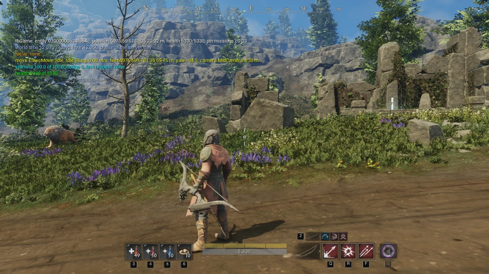
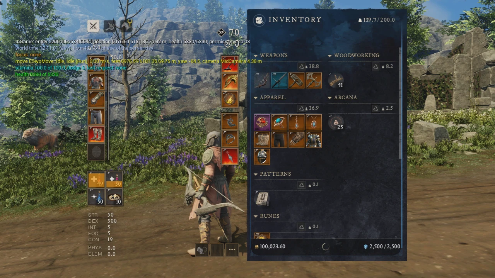

# Soulwarden Client

An open world game client for New World, written in Unreal Engine 5.8. It connects to
[Soulwarden](https://github.com/DevNvll/soulwarden), an offline server for the last retail New World client, and it
speaks the original wire protocol. The goal is the feel of the gameplay and the UI of the retail client; the world
look follows the game data, and the rendering uses Unreal where Unreal does it better.

This is a personal hobby project. It is not affiliated with or endorsed by Amazon Games.

## What it does

- Converts the content of a local game copy (meshes, characters, animations, textures, materials, terrain, the
  placements of the 49 world regions) into Unreal assets, and builds one streamed World Partition level of the world.
- Logs in to a Soulwarden backend and enters the world at the place of the character, with the same characters as
  the retail client.
- Runs the original UI scripts (Lua 5.1) on the original UI canvases, with an emulation of the engine buses.
- Plays the character, its gear, the movement, the camera, the combat actions of the game data, the creatures of the
  server, the world objects (chests, gathering, lore pages), the water, the time of day, and the local lights.

The status of each part is in [docs/ROADMAP.md](docs/ROADMAP.md) and [docs/PARITY.md](docs/PARITY.md).

## Screenshots

A level 70 character with a bow in the open world, with the HUD of the original UI scripts (the compass, the
consumable quick slots, the health bar, and the weapon abilities). The text at the top left is the debug overlay of a
development run.



The inventory and the equipment of the same character, drawn from the original UI canvas and scripts with the item
data of the server.



## Game data and legal

This repository has only source code, scripts, tests, documents, and a few screenshots of this client
(`docs/screenshots/`). It has no game data: no texture, mesh, map, sound, or script of the game. The converter reads your own game copy on your computer, and the converted and imported
content stays outside the repository.

You need your own copy of New World (Steam app 1063730, client build 1.400.6031.6004151). New World is a trademark of
its owner.

## Requirements

- Linux (the run tools use user and network namespaces).
- Unreal Engine 5.8 (an installed build). Its Oodle library also decodes the game archives.
- Python 3 with numpy and Pillow (numba for the software previews).
- A release of the [Soulwarden](https://github.com/DevNvll/soulwarden) backend and its game data.
- About 100 GB of free disk for the converted and imported content of the whole world.
- For window runs of the development tools: gamescope on an Omarchy agent desktop (`omarchy-agent-desktop`). The
  runs with no window (`-nullrhi`) and the tests do not need it.

## Configuration

`tools/env.sh` sets all paths. Each value has a default and can be set in the environment before a tool runs:

| Variable | Meaning |
| --- | --- |
| `SOULWARDEN_GAME_DIR` | The game copy (read only). |
| `UE_ROOT` | The Unreal Engine 5.8 installation. |
| `SWC_WORK` | The work folder outside the repository: the converted content, the imported content plugin, the logs. |
| `SOULWARDEN_RELEASES` | The releases of the Soulwarden backend (read only). |
| `SOULWARDEN_REPO` | A checkout of the Soulwarden repository (read only; some converter readers use its game data tools). |
| `SWC_DEV_DATA` | The data folder of the development runs (its own database and a test character). |

## Quick start

```sh
tools/backend-update.sh        # copy the backend and its game data of a Soulwarden release
tools/build.sh editor          # build the C++ modules
tools/convert.sh proofs        # convert a small test set of the game content
tools/import.sh                # import the converted content into the content plugin (no window)
tools/dev-run.sh --window --enter   # a development run: the backend and the client, into the world
```

The cooked build loads much faster (the world entry about 44 s against 70 to 87 s with the editor binary):

```sh
tools/cook.sh                  # cook and stage the whole world (cold: about 45 min; again with no change: 2.5 min)
tools/play.sh                  # the player run: the cooked build when it is current, else the editor binary
tools/dev-run.sh --window --cooked --enter   # a development run with the cooked build
```

After an import, a converter change of the content, or a change of the client code (Source, Lua, Config), the cooked build
is old: `tools/play.sh` uses the editor binary (and says why) until `tools/cook.sh` runs again. See docs/WORLD.md "The
cooked build".

The whole world needs more steps (the census, the region conversion, the world build, the creatures, the UI, the
materials, the environment). [AGENTS.md](AGENTS.md) lists each tool in its section "Common workflows", and
[docs/WORLD.md](docs/WORLD.md) describes the world pipeline.

## Layout

| Path | Content |
| --- | --- |
| `converter/` | The Python converter of the game formats (archives, meshes, skeletons, animations, textures, terrain, placements, materials, UI canvases). |
| `unreal/SoulwardenClient/` | The Unreal project: the client module, the editor module, the UI runtime, the import scripts. |
| `tools/` | The shell tools for conversion, import, world build, runs, and tests. |
| `tests/` | The tests of the converter, the network codec, the UI runtime, and the game rules, plus the drive scripts of the runs. |
| `docs/` | The design and the rules of each system. |

## Documents

[docs/ARCHITECTURE.md](docs/ARCHITECTURE.md) has the design. Each system has its own document: the network
([NETWORK.md](docs/NETWORK.md)), the world ([WORLD.md](docs/WORLD.md)), the character ([CHARACTER.md](docs/CHARACTER.md)),
the movement ([MOVEMENT.md](docs/MOVEMENT.md)), the camera ([CAMERA.md](docs/CAMERA.md)), the actions
([ACTIONS.md](docs/ACTIONS.md)), the creatures ([CREATURES.md](docs/CREATURES.md)), the objects
([OBJECTS.md](docs/OBJECTS.md)), the UI ([UI.md](docs/UI.md)), the materials ([MATERIALS.md](docs/MATERIALS.md)),
the environment ([ENVIRONMENT.md](docs/ENVIRONMENT.md)), and the water ([WATER.md](docs/WATER.md)).

## License

MIT, see [LICENSE](LICENSE). The vendored code keeps its own license (Lua 5.1.5, stb, OpenSimplex noise, the
Soulwarden readers); see the NOTICE and LICENSE files next to it.
